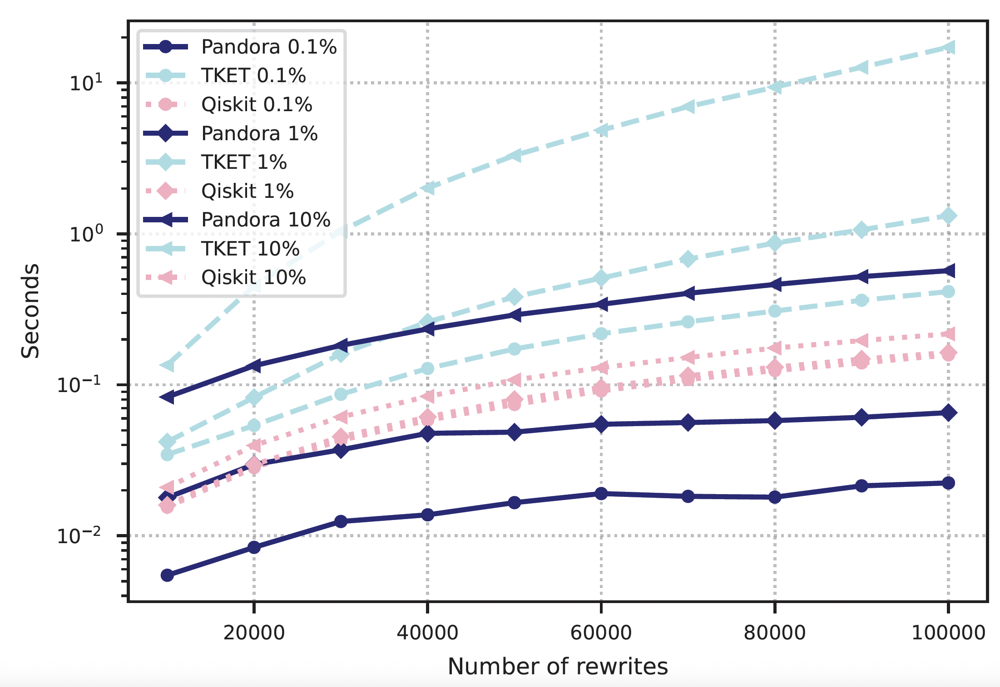
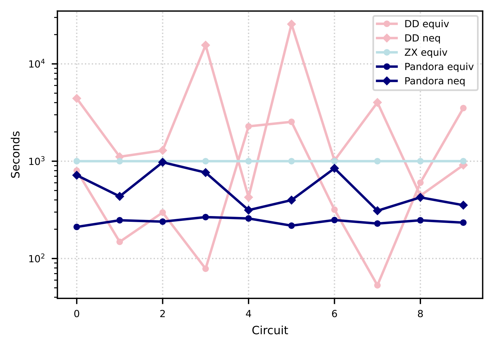

# Pandora: Ultra-Large-Scale Quantum Circuit Design Automation

## About
**[Pandora](https://arxiv.org/abs/2508.05608)** is an open-source tool for compiling, analyzing and optimizing quantum circuits through template rewrite rules. 
The tool can easily handle quantum circuits with billions of gates, and can operate in a multi-threaded manner 
offering almost linear speed-ups. Pandora can apply thousands of complex circuit rewrites per second at random circuit locations.

Pandora is HPC friendly and can be used for:
* Faster and more insightful analysis of quantum circuits
* Faster compilation for practical, fault-tolerant QC
* Faster and multi-threaded optimization for practical, fault-tolerant QC
* Fast widgetisation. A widget is a partition of the circuit which obeys some architectural constraints.

**Pandora** can take input circuits from / export to:
* <a href="https://github.com/quantumlib/Qualtran" target=_blank>Google Qualtran</a> and <a href="https://github.com/isi-usc-edu/pyLIQTR" target=_blank>pyLIQTR</a>.
* Google Cirq
* Qiskit

## Containers on Toubkal and LUMI

The container includes PostgreSQL, Python, Pandora, and the RSA dependencies from
`.[rsa]`. Docker does **not** need to be installed: Apptainer/Singularity downloads
and converts the PostgreSQL image directly from Docker Hub. Build the image once,
then use it for subsequent jobs.

### Prepare the repository

Clone the repository onto storage accessible from the cluster's compute nodes:

```bash
git clone https://github.com/ioanamoflic/pandora.git
cd pandora
```

If you already have a clone, update that checkout instead. The commands below
start from the repository root unless stated otherwise. Keep the whole checkout
on the cluster, including `main.py`, `src/`, the cluster launchers, and these
helper files:

```text
apptainer/project.apptainer
apptainer/apptainer_util.sh
apptainer/cluster_util.sh
apptainer/slurm_node.sh
apptainer/run_node.sh
```

Copying only `run_apptainer_lumi.sh` or `run_apptainer_toubkal.sh` is insufficient.
When transferring changes with Git, include newly added files in the commit.
Choose a writable scratch directory for the databases; each billion of gates in
Pandora format takes approximately 100 GB of storage.

### Prepare Singularity on the cluster

Both Toubkal and LUMI provide Singularity, so the image pull and build commands
below are the same on both clusters. The setup needed to permit an unprivileged
build depends on the cluster.

On **Toubkal**, make `singularity` available in your shell, loading the site's
module if needed, and check it with `singularity --version`. Use the build mode
supported by the site's Singularity installation; the LUMI module names below
are specific to LUMI.

On **LUMI**, enable its unprivileged PRoot build procedure before building:

```bash
module load CrayEnv
module load PRoot
```

LUMI disables ordinary root/fakeroot builds. See its
[container guide](https://docs.lumi-supercomputer.eu/software/containers/singularity/)
for the supported PRoot procedure. The same `singularity build` command is used
once the build environment is ready.

### Build the image on either cluster

From the repository root, after preparing Singularity as above:

```bash
# Keep download/build caches out of your home directory.
mkdir -p "/tmp/$USER/pandora-build/tmp" "/tmp/$USER/pandora-build/cache"
export SINGULARITY_TMPDIR="/tmp/$USER/pandora-build/tmp"
export SINGULARITY_CACHEDIR="/tmp/$USER/pandora-build/cache"

cd apptainer
mkdir -p images
singularity pull images/postgres:17-bookworm.sif docker://postgres:17-bookworm
singularity build images/pandora.sif project.apptainer
cd ..

# Check the completed image and installed packages.
singularity exec apptainer/images/pandora.sif python3 -m pip show pandora numpy
```

The pull creates `apptainer/images/postgres:17-bookworm.sif`; it does not require
an existing PostgreSQL image or a Docker installation. If that base image already
exists, skip the pull. The build creates `apptainer/images/pandora.sif`.

Run the direct build command from `apptainer/`: both the base-image path and the
recipe's source-copy path are relative to that directory. Building requires
internet access and must run on a node where your cluster permits container
builds. Use a build/cache directory with enough free space if `/tmp` is too small.

Use the recipe's `postgres:17-bookworm` base image, which provides Python 3.11.
Do not substitute `postgres:latest`: it can change the Debian and Python versions
and cause incompatible dependency selections or unsupported NumPy source builds.

Alternatively, transfer a completed Linux x86-64 `pandora.sif` from a compatible
build machine into `apptainer/images/`. The PostgreSQL base image alone is not
the completed Pandora image.

For machines exposing the runtime as `apptainer`, the equivalent helper commands
from the repository root are `bash apptainer/apptainer_util.sh base` and
`bash apptainer/apptainer_util.sh build`. That helper currently calls `apptainer`
explicitly; use the direct Singularity commands above on Singularity-only systems.

### Run RSA decomposition on LUMI

Set your own LUMI account and scratch directory. Replace `project_YOUR_PROJECT`
in both values:

```bash
export PANDORA_ACCOUNT=project_YOUR_PROJECT
export PANDORA_DATA_ROOT="/scratch/$PANDORA_ACCOUNT/$USER/pandora-db"

# One node, four decomposition workers.
bash run_apptainer_lumi.sh main.py rsa --n 64 --nodes 1 --nproc 4
```

You can run this command from the login node. Outside an allocation, the launcher
submits one batch job with `sbatch` and returns its job ID; Python runs on the
allocated compute nodes. There is no separate `salloc` step. Inside an existing
allocation, the launcher uses that allocation instead.

For decomposition across three nodes, with four workers on each node:

```bash
bash run_apptainer_lumi.sh main.py rsa --n 64 --nodes 3 --nproc 4
```

Submission defaults are 30 minutes, 8 GB of memory per node, and `--nproc` CPUs per
node. The launcher selects `small` for up to four nodes and `standard` for larger
jobs. The `standard` partition allocates and bills full nodes; consult
[LUMI's partition limits](https://docs.lumi-supercomputer.eu/runjobs/scheduled-jobs/partitions/)
when sizing your job. Override resources before submission, for example:

```bash
export PANDORA_TIME=02:00:00
export PANDORA_MEM=32G
export PANDORA_CPUS=8
```

`PANDORA_CPUS` must be at least `--nproc`. `PANDORA_PARTITION` overrides the automatic
partition choice. Resource overrides do not resize an existing allocation.
Always set `PANDORA_ACCOUNT` for your own project: the current fallback account
in the script is `project_462001731`.

### Run RSA decomposition on Toubkal

The Toubkal launcher expects an existing Slurm allocation. For a batch job, create
`pandora-toubkal.sbatch` in the repository root:

```bash
#!/usr/bin/env bash
#SBATCH --job-name=pandora
#SBATCH --account=YOUR_PROJECT_ACCOUNT
#SBATCH --partition=compute
#SBATCH --nodes=3
#SBATCH --ntasks=3
#SBATCH --ntasks-per-node=1
#SBATCH --cpus-per-task=4
#SBATCH --mem=8G
#SBATCH --time=00:30:00
#SBATCH --output=pandora-%j.out
#SBATCH --error=pandora-%j.err

set -euo pipefail
cd /path/to/pandora
# Load the site's Singularity module here if it is not already available.
export PANDORA_DATA_ROOT=/path/to/your/scratch/pandora-db
bash run_apptainer_toubkal.sh main.py rsa --n 64 --nodes 3 --nproc 4
```

Replace the account, repository path, and scratch path, then submit from the
repository root:

```bash
sbatch pandora-toubkal.sbatch
```

The example uses Toubkal's `compute` CPU partition; use the partition and account
authorized for your project. See the
[Toubkal job-submission guide](https://toubkal.gitlab.io/docs/user-guide/job-submission.html)
for site-specific account and QoS requirements. The launcher prefers `apptainer`
and falls back to `singularity` if that is the available runtime.

For one-node decomposition, change the batch script's `--nodes` and `--ntasks`
to `1`, and change the Python command to `--nodes 1`. Keep `--cpus-per-task` at
least as large as `--nproc`. Do not add another `srun` around the launcher; it
already starts one container task per node.

For an interactive allocation, the equivalent three-node example is:

```bash
salloc --account=YOUR_PROJECT_ACCOUNT --partition=compute \
  --nodes=3 --ntasks=3 --ntasks-per-node=1 --cpus-per-task=4 \
  --mem=8G --time=00:30:00

# Once Slurm grants the allocation, from the repository root:
export PANDORA_DATA_ROOT=/path/to/your/scratch/pandora-db
bash run_apptainer_toubkal.sh main.py rsa --n 64 --nodes 3 --nproc 4
# Run exit when finished to release the interactive allocation.
```

### How multi-node decomposition works

The same RSA arguments apply to both cluster launchers:

| Argument | Meaning |
| --- | --- |
| `--n 64` | Select the 64-bit RSA instance. |
| `--nodes 3` | Split decomposition across three compute nodes; defaults to one. |
| `--nproc 4` | Start four decomposition worker processes on each node. |

`--nodes 3 --nproc 4` starts **12 decomposition workers in total**, with one
container and one PostgreSQL instance per node. The launcher assigns node IDs
`0`, `1`, and `2` automatically. Each node receives a distinct contiguous chunk
of the high-level circuit and splits that chunk among its local workers. The
former `--container_id` option has been replaced by `--nodes`; do not submit a
separate command for each chunk.

Each node stores its output in its own database. The databases are **not merged**
into a single circuit database. A failed worker causes the job to report failure.
Use a cluster launcher for multiple nodes: running `python main.py ... --nodes 3`
directly does not create Slurm tasks.

### Logs, results, and job monitoring

On LUMI, batch output is written to:

```text
container_outputs/pandora-<jobid>.out
container_outputs/pandora-<jobid>.err
```

Set `PANDORA_LOG_DIR` to change this directory. The Toubkal batch example above
writes `pandora-<jobid>.out` and `.err` in the submission directory. Monitor or
cancel either cluster's job with:

```bash
squeue -u "$USER"
sacct -j JOB_ID --format=JobID,State,ExitCode,Elapsed
scancel JOB_ID
```

The launcher prints the database location. Under `PANDORA_DATA_ROOT`, each run has
this layout:

```text
pandora-<jobid>.<unique-suffix>/
  node-0/
    pgdata/
    pgrun/
    postgres.log
    db-settings
  node-1/
    ...
```

PostgreSQL stops when the node's command exits, but the data, selected connection
settings, and logs are retained. Every invocation initializes fresh databases;
retained databases are not automatically reopened or resumed. If
`PANDORA_DATA_ROOT` is unset, the launchers use `$SCRATCH` when available; LUMI's
automatic submission otherwise defaults to `/scratch/<account>/$USER/pandora-db`.
Toubkal requires `PANDORA_DATA_ROOT` or `$SCRATCH`.

Set `PANDORA_IMAGE` to an absolute path to use a SIF outside
`apptainer/images/pandora.sif`. Repository source changes are read through a bind
mount and do not require rebuilding the image; dependency or recipe changes do.

### Optional PostgreSQL settings

A database configuration is optional. Without one, the launcher creates a local
PostgreSQL instance with the submitting user's database role, the `postgres`
database, and an automatically selected available port. For a custom role or
database, create `config.json` in the repository root:

```json
{
  "host": "localhost",
  "user": "pandora",
  "database": "pandora"
}
```

Place `--config` **before** `rsa`, for example on LUMI:

```bash
bash run_apptainer_lumi.sh main.py --config config.json rsa \
  --n 64 --nodes 3 --nproc 4
```

The same placement works with `run_apptainer_toubkal.sh`. The launcher creates the
configured role and database on every node. Its database must be local, so use
`localhost`, `127.0.0.1`, or `::1` for `host`. You may specify a `port`, but leaving
it unset lets the launcher select an available port. These instances use trust
authentication for local connections on the compute node.

### Troubleshooting container setup

| Error | What to check |
| --- | --- |
| Missing `apptainer/cluster_util.sh`, `slurm_node.sh`, or `run_node.sh` | Update the entire checkout, including the three helper scripts. |
| Helper lookup starts with `/var/spool/slurmd/...` | Update `run_apptainer_lumi.sh` and resubmit. It preserves the checkout path through `sbatch` and can recover it from `SLURM_SUBMIT_DIR`. For a checkout outside the submission directory, export `PANDORA_REPO_DIR` with its absolute path before submission. Already queued jobs retain their submitted script. |
| `Container image not found` | Build the final `pandora.sif`, or set `PANDORA_IMAGE` to its absolute path. |
| `open images/tmp-copy-...: no such file or directory` | Run `mkdir -p images` inside `apptainer/` before pulling the base image. |
| `Obtaining file:///` and missing `src` | Use the current recipe, which copies the checkout into `/pandora` and installs `/pandora[rsa]`. |
| `openssh-client` fails while creating `_ssh` under PRoot | Keep `--no-install-recommends` in the recipe's `apt-get install` command. |
| NumPy 1.26.x downloads as source and fails to build | Use the Bookworm base and its Python 3.11, rather than `postgres:latest`. |
| `Run this launcher inside an sbatch job or salloc allocation` | On Toubkal, use the batch or interactive allocation example above. |
| Allocation has too few nodes or CPUs | Match the Slurm request to `--nodes` and `--nproc`; resource overrides cannot enlarge an existing allocation. |

For benchmarks that do not require PostgreSQL, the existing
`run_apptainer_no_postgres.sh` launcher is also available. Additional recipe notes
are in [apptainer/README.md](apptainer/README.md).

## Without Apptainer
* Install PostgreSQL and get a server running. For example, on MacOS you can use [this tutorial](https://www.atlassian.com/data/sql/how-to-start-a-postgresql-server-on-mac-os-x).
* `python3.10 main.py rsa --n 64 --nproc 1 --nodes 1` for building and decomposing an 64-bit RSA instance into Pandora.

## Widgetization
This is an example of a widgetised Fermi-Hubbard instance (N=2) decomposed into Clifford+T with around 58K gates.
Each frame is a visualisation of the widgets with d3 (each node is a gate, the color identifies the widget) for different parameters.


<a href="./vis/index.html" target=_blank>This is an example of a widgetised 2-bit adder.</a>

## Benchmarks
For details and more results, see the Pandora manuscript https://arxiv.org/abs/2508.05608.

Examples of how to run some of the benchmarks from the manuscript can be found in the ```examples``` folder. 

### Single-threaded performance 
* Pandora vs. TKET or Qiskit for rewriting a specific gate pattern, when the pattern is encountered in the circuit with a certain probability (0.1%, 1% and 10%);

* see ```examples/speed_benchmark.md``` for instructions on replicating this benchmark

### Equivalence checking

* see ```examples/equivalence.md``` for instructions on replicating this benchmark

### Issues
* There is a compatibility issue between Qualtran and pyLIQTR. In order to decompose RSA, we require the latest version of Qualtran (0.6),
which is incompatible with pyLIQTR (on which we rely for Fermi-Hubbard circuit decompositions). Therefore, you must choose the respective mode during installation with `pip install -e '.[rsa]'` or `pip install -e '.[fh]'`.
  
## Citing Pandora
Please use
```
@article{moflic2025ultra,
  title={Ultra-Large-Scale Compilation and Manipulation of Quantum Circuits with Pandora},
  author={Moflic, Ioana and Paler, Alexandru},
  journal={arXiv preprint arXiv:2508.05608},
  year={2025}
}
```

## Acknowledgements
**This research was performed in part with funding from the Defense Advanced Research Projects Agency [under the Quantum Benchmarking
(QB) program under award no. HR00112230006 and HR001121S0026 contracts].**

## SQL code example explanation
```sql
create or replace procedure cancel_single_qubit(type_1 int, type_2 int, param_1 float, param_2 float, pass_count int, timeout int)
    language plpgsql
as
$$
    --     We are performing this rewrite:
    --
    --     First (type_1, param_2) ---- Second (type_2, param_2) ----  =  ------------

    --     LinkID (edge in the circuit DAG) has the format *IPTT where:
    --     - unlimited number of digits for the gate id I
    --     - one digit for the port P. For example, a CNOT gate has 2 ports, a Toffoli has 3 ports etc.
    --     - two digits for the gate type T. For example, a Toffoli is 23, a CNOT is 15/18 etc.
    --
    --     Considering the LinkID X, in order to:
    --     - get the gate id: X / 1000 will return the *I digits
    --     - get the port number: (X / 100) % 10 will return the P digit
    --     - get the type: X % 100 will return the T digits
declare
    -- helper variables
    first_prev_id bigint;
    second_next_id bigint;

    gate record;
    first record;
    second record;

    a record;
    b record;

	start_time timestamp;

begin
    start_time := clock_timestamp();
     -- pass_count is usually set for benchmarking purposes (we know exactly how many templates we should
     -- rewrite), otherwise it is set to a very large number
     -- we should never loop infinitely as we have a timeout set (see below)
	 while pass_count > 0 loop
   	    -- loop through all candidate gates that currently fit the pattern we are looking for:
	      -- first gate (L) with type = type_1 and parameter = param_1 having a neighbouring second gate (R)
        -- which also has the type type_2 (see *IPTT format)
        for gate in
            select * from linked_circuit
                     where
                       type = type_1
                       and param = param_1
                       and get_type_from_link(next_q1) = type_2
        loop
            -- attempt to lock the two gates
            -- if not already locked by another process (skip locked), lock the pair of gates (for update)
            select * into first from linked_circuit where id = gate.id for update skip locked;
            select * into second from linked_circuit where id = get_id_from_link(first.next_q1) for update skip locked;

            -- if acquiring locks is not successful (e.g. gates deleted already by another process),
            -- commit and move to the next candidate pair
            -- locks are released at commit!
            if first.id is null
                or second.id is null
            then
                commit;
                continue;
            end if;

            -- if gates were updated by another process during the traversal of the for loop
            -- and do not match the template pattern anymore
            -- commit and move to the next candidate pair
            if first.param != param_1
                or second.param != param_2
                or first.type != type_1
                or second.type != type_2
            then
                commit;
                continue;
            end if;

            
          if get_id_from_link(second.prev_q1) != first.id
			      or get_id_from_link(first.next_q1) != second.id
            then
                commit;
                continue;
            end if;

            -- compute the ids of the two gates (see *IPTT format)
            first_prev_id := get_id_from_link(first.prev_q1);
            second_next_id := get_id_from_link(second.next_q1);

            -- attempt to lock the neighbours of the pair (left of first gate and right of second gate)
            -- this is needed as we have to update the LinkIDs and we need to lock the neighbours pointing to
            -- the pair as well
            select * into a from linked_circuit where id = first_prev_id for update skip locked;
            select * into b from linked_circuit where id = second_next_id for update skip locked;

            -- if locking the neighbours failed, commit and move to the next candidate pair
            if a.id is null
                or b.id is null
            then
                commit;
                continue;
            end if;
            -- if we made it this far, it means we have managed to acquire all the necessary locks
            -- before deleting the single-qubit gate pair, we make sure to update the links of the neighbours

            -- we link the left neighbour of the first gate to the right neighbour of the second gate (see *IPTT format)
            if get_port_from_link(first.prev_q1) = 0 then
                update linked_circuit set next_q1 = second.next_q1 where id = first_prev_id;
            else
                update linked_circuit set next_q2 = second.next_q1 where id = first_prev_id;
            end if;
            -- we link the right neighbour of the second gate to the left neighbour of the first gate (see *IPTT format)
            if get_port_from_link(second.next_q1) = 0 then
                update linked_circuit set prev_q1 = first.prev_q1 where id = second_next_id;
            else
                update linked_circuit set prev_q2 = first.prev_q1 where id = second_next_id;
            end if;
            -- neighbouring links are updated, the only thing left to do is to delete the rows in the database
            delete from linked_circuit where id in (first.id, second.id);

            commit; -- release the locks

        end loop; -- end gate loop
        
      -- we finished a circuit pass
	    pass_count = pass_count - 1;

      -- if we exceeded the allotted time, return to avoid looping infinitely
	    if extract(epoch from (clock_timestamp() - start_time)) > timeout then
            exit;
        end if;

    end loop; -- end pass loop
end;$$;

```
